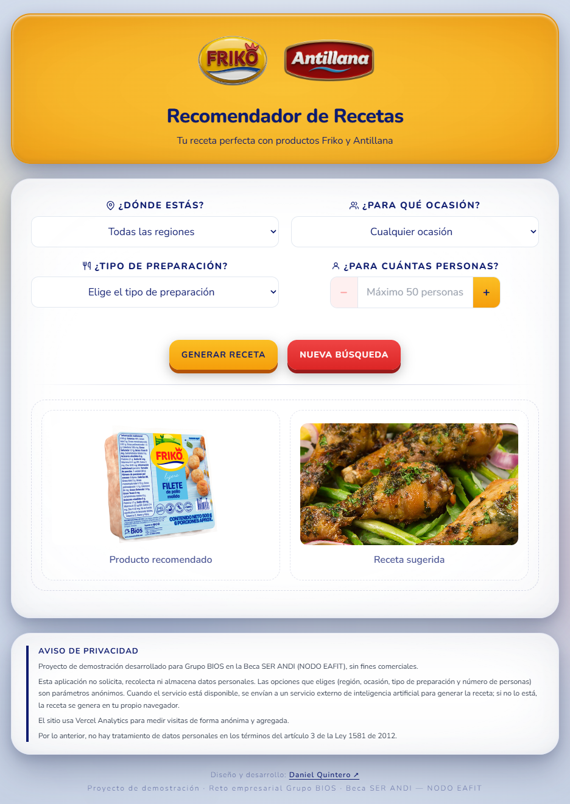
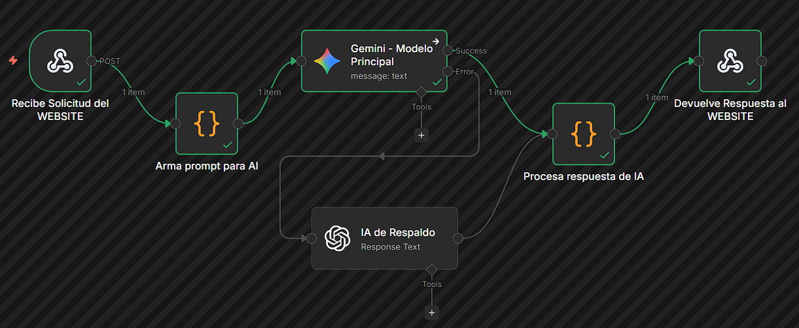
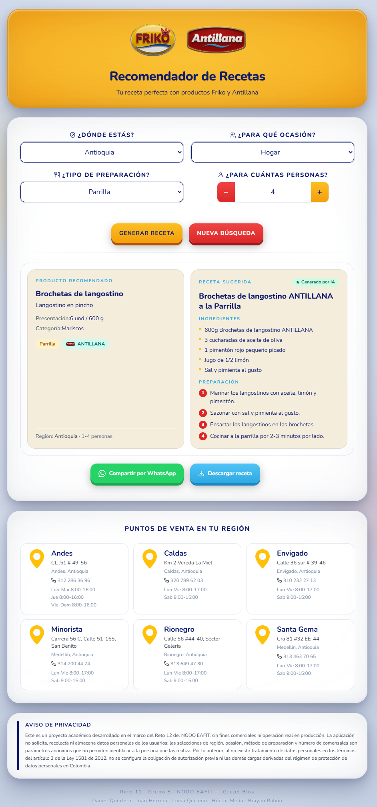

# Bios Recipe Recommender — Friko & Antillana


An MVP recipe recommender built for the **Grupo BIOS business challenge · Beca SER ANDI — NODO EAFIT**. Users filter Friko and Antillana products by region, occasion, cooking method, and number of people — the app then recommends a matching product from a 75-item catalog and generates an AI-powered recipe suggestion on demand.

🔗 **Live site:** [bios-recetas-ia.vercel.app](https://bios-recetas-ia.vercel.app)

> **Note:** the n8n AI flow is no longer active, so the live demo shows fallback recipes.

---



---

## Overview

The user selects up to four filters (region, occasion, cooking method, number of people), and the app resolves the best-matching Friko or Antillana product from a static local catalog. Once a product is found, the frontend sends its metadata to an n8n webhook, which constructs a strict-JSON prompt and forwards it to Google Gemini (Gemma-3-27b-it) as the primary model. If Gemini fails, the request goes to GPT-4o. The response is parsed by a model-agnostic code node and rendered alongside the product card in real time.

---

## Key Features

- **Filter-based recommendation engine** over a 75-product catalog (Friko + Antillana)
- **Four filter dimensions:** region, occasion, cooking method, and number of people
- **Inferred fields** (`Rango_Personas`, `Ocasion`) derived from raw catalog data, preprocessed with a Python notebook outside this repository, keeping the original Bios dataset untouched
- **AI-generated recipes** via n8n orchestration with **dual-model architecture** (Gemini primary, GPT-4o fallback)
- **JSON-strict prompt engineering** with model-agnostic response parser
- **Graceful local fallback recipe** — used when `VITE_N8N_WEBHOOK_URL` is not set or the n8n call fails, so the UI never crashes; if no product matches, filters are relaxed in three steps (cooking method, then occasion, then number of people)
- **Download recipe as image** via `modern-screenshot` (PNG export from DOM)
- **WhatsApp share** for generated recipes
- **Store locator by region** — points of sale for the selected region, loaded from `public/data/tiendas_friko.json`
- **Single-page responsive layout** with custom Nunito font and mobile-first breakpoints
- **Inline SVG icons** — no icon library added to the bundle
- **Deployed on Vercel** with automatic deploys from `main`

---

## Tech Stack

| Layer | Technology |
|---|---|
| Frontend Framework | React 19 |
| Build Tool | Vite 8 |
| Styling | Tailwind CSS 3 |
| Backend Orchestration | n8n Cloud workflow |
| AI — Primary | Google Gemini (Gemma-3-27b-it) |
| AI — Fallback | OpenAI GPT-4o |
| Image Export | modern-screenshot |
| Hosting | Vercel |
| Data Source | Static JSON catalog (preprocessed from Excel with a Python notebook outside this repository) |

---

## Project Structure

```
├── n8n/
│   └── workflow.json           # n8n workflow export (webhook → AI → response)
├── public/
│   ├── data/                   # Product catalog and store locations (JSON)
│   ├── images/                 # Product and recipe images
│   ├── logos/                  # Friko and Antillana logos, map marker
│   ├── screenshots/            # README assets
│   ├── favicon.svg
│   └── og-image.png            # Social preview image (Open Graph)
├── src/
│   ├── RecomendadorFriko.jsx   # Main component (catalog, filter logic, UI)
│   ├── App.jsx                 # Root app shell
│   ├── main.jsx                # Vite entry point
│   └── index.css               # Tailwind directives
├── .env.local.example          # Template for the n8n webhook URL
├── .dockerignore
├── Dockerfile                  # Two-stage build (Vite → nginx)
├── README-docker.md            # Docker instructions
├── nginx.conf
├── eslint.config.js
├── index.html
├── package.json
├── tailwind.config.js
├── postcss.config.js
└── vite.config.js
```

---

## Getting Started

### Prerequisites

- Node.js 20.19+ or 22.12+
- An n8n instance (self-hosted or cloud) with **two credentials configured**: Google Gemini API and OpenAI API

### Installation

```bash
git clone https://github.com/CauseofDeathLife/ai-recipe-recommender.git
cd ai-recipe-recommender
npm install
```

### Environment Variables

Create `.env.local` at the project root:

```env
VITE_N8N_WEBHOOK_URL=https://your-n8n-instance.app/webhook/generar-receta
```

### Development

```bash
npm run dev
```

Then open `http://localhost:5173`.

### Build

```bash
npm run build
npm run preview
```

Output is placed in the `dist/` directory.

---

## How It Works — n8n + AI Integration



The workflow is committed at `n8n/workflow.json` for reference and reproducibility. It implements a **dual-model architecture** for resilience across six nodes:

1. **Webhook (`/generar-receta`)** — receives a POST request from React with `{ producto, marca, descripcion, presentacion, preparacion_elegida, personas }`
2. **Code node — Build Prompt** — validates the incoming payload and constructs a strict-JSON prompt requesting a recipe with a maximum of 5 ingredients and 4 preparation steps, scaled to the requested number of people
3. **Gemini node (primary)** — calls `models/gemma-3-27b-it`. If Gemini fails, the request goes to GPT-4o.
4. **OpenAI node (fallback)** — calls `gpt-4o` and takes over when the Gemini node fails
5. **Code node — Parse Response** — model-agnostic parser that detects which model responded by inspecting the JSON shape (`content.parts[0].text` for Gemini, `output[0].content[0].text` for the n8n OpenAI node), also accepts the standard `choices[0].message.content` format, strips Markdown code fences, and returns a pre-built fallback recipe object if parsing fails
6. **Respond to Webhook** — returns the final recipe JSON to the React frontend

> **Why dual-model?** Relying on a single AI provider creates a single point of failure. If Gemini's API is rate-limited or unavailable, the workflow automatically continues through OpenAI without any user-visible degradation.

---

## Full Layout Preview



Full vertical layout showing all sections of the application.

---

## Deployment

The app is hosted on Vercel with automatic deploys triggered on every push to the `main` branch. Build command: `npm run build`. Output directory: `dist`. The `VITE_N8N_WEBHOOK_URL` environment variable must be added to the Vercel project settings so the frontend can reach the n8n webhook at runtime.

---

## Docker

The image is built from source with the two-stage `Dockerfile`: Node 22 compiles the app with Vite, then nginx serves the static files. No Node.js is needed on the host, only Docker. See [README-docker.md](README-docker.md) for the build and run steps.

---

## Design Decisions

- **Static catalog over database** — 75 products fit comfortably in a static JSON file; avoiding a database simplifies hosting and removes a failure point for an MVP
- **Inferred fields via notebook** — `Rango_Personas` and `Ocasion` were derived from `Presentación` text with a Python notebook outside this repository, rather than added to the source data, keeping the original Bios catalog untouched
- **n8n over a custom backend** — visual workflow orchestration lets non-developers on the team understand and modify the AI integration without reading code
- **Dual-model architecture** — running Gemini as primary with GPT-4o as fallback eliminates single-provider risk; the parser is model-agnostic so swapping or adding models requires no frontend changes
- **Strict JSON prompt + universal parser** — both models occasionally return Markdown-wrapped JSON; the parse node strips fences, evaluates the response shape dynamically, and returns a graceful fallback recipe instead of crashing the UI
- **No icon library** — inline SVG icons keep the bundle small and avoid version-pinning a dependency for a handful of icons
- **Nunito font via Google Fonts CDN** — single font family across the app, loaded once

---

## Author

**Daniel Esteban Quintero Caro** — Full Stack Developer

- [GitHub: CauseofDeathLife](https://github.com/CauseofDeathLife)
- [Linktree](https://linktr.ee/DanielEstebanQuintero)
- [LinkedIn](https://www.linkedin.com/in/danielesban/)

---

## License

This project was developed as an MVP for an educational challenge
(Grupo BIOS business challenge · Beca SER ANDI — NODO EAFIT). The source code is hosted on
GitHub for portfolio purposes under **All Rights Reserved**.

Brand assets (Friko and Antillana logos), product catalog data, and
recipe information were provided by Grupo Bios under the scope of
this academic project and remain property of their respective owners.
These assets are included in the repository for demonstration purposes
only and may not be reused, redistributed, or repurposed without
explicit permission from Grupo Bios.

**Authorship**

Developed as a team challenge. **All software (design, architecture and development) was built by Daniel Esteban Quintero Caro, the team's sole developer:** React code, UI design, project structure and the integration with the n8n workflow. The rest of the team contributed research and documentation for the challenge deliverables (presentations and reports).

Built during Stage 3 (Business Challenges) of the Beca SER ANDI, operated by NODO — Universidad EAFIT, as a demonstration project for Grupo Bios.
